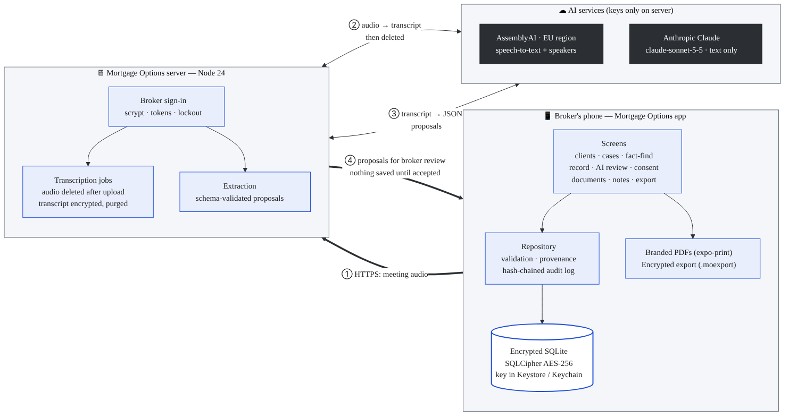
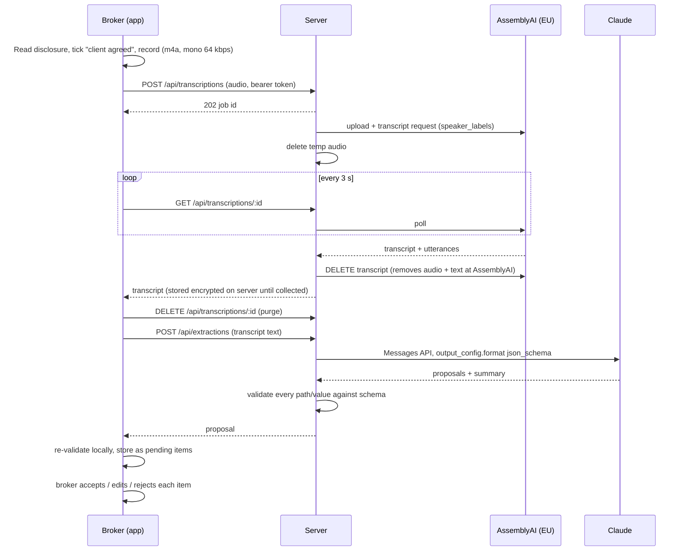

# Architecture

Source: [`architecture.mmd`](architecture.mmd) (Mermaid). Rendered: [`architecture.svg`](architecture.svg).

## Principles

1. **Client data lives on the broker's phone.** It sits in an encrypted SQLite database. The server holds no client records, only short-lived, encrypted transcripts.
2. **AI keys never touch the phone.** The app talks only to the Mortgage Options server. The server talks to AssemblyAI and Anthropic.
3. **AI proposes, the broker decides.** Extraction output is stored as proposals with a confidence score and a supporting quote. Nothing reaches the fact-find until the broker accepts or edits it. The provenance of every accepted value is kept and shown in the PDF.
4. **Everything is audited, without personal data.** Each change appends a SHA-256 hash-chained entry. Database triggers block updates and deletes. Because audit entries never contain names or values, erasing a client doesn't break the chain.
5. **One schema drives everything.** `shared/src/factfind/schema.ts` drives the forms, validation, completeness, the AI field catalogue and JSON schema, and the PDFs.

## Meeting → fact-find sequence

## Components

| Component | Key files | Notes |
|---|---|---|
| Fact-find schema & validation | `shared/src/factfind/*` | 17 sections, 143 field definitions (167 scalar fields on a joint case, plus 8 repeating lists); UK formats (DD/MM/YYYY, £, postcodes) |
| Persistence | `shared/src/db/*`, `app/src/lib/db.ts` | One repository used by app (expo-sqlite + SQLCipher) and tests (node:sqlite); migrations via `PRAGMA user_version` |
| Audit chain | `shared/src/audit.ts` | Hash-chained, append-only triggers, verified on screen and in PDF |
| Consent | `shared/src/consent.ts`, `app/src/app/cases/[id]/consent.tsx` | Versioned wording, text hash, signature hash, record hash, UTC + local time + zone, device, witness |
| Signature | `shared/src/signature.ts`, `app/src/components/SignaturePad.tsx` | Finger strokes → SVG data URL (no WebView); taps rejected |
| AI contract | `shared/src/extraction.ts` | System prompt, field catalogue, JSON schema, normalisation, conflict handling |
| API client | `shared/src/apiClient.ts` | `ServerBackend` (HTTPS) and `OfflineDemoBackend` (no network) |
| Server | `server/src/*` | `node:http`, `node:sqlite`, `node:crypto`; no npm dependencies |
| PDFs | `shared/src/pdf/templates.ts`, `app/src/lib/pdf.ts` | HTML escaped; rendered by expo-print on device |
| Secure export | `shared/src/secureExport.ts`, `server/scripts/decrypt-export.ts` | AES-256-GCM, PBKDF2-SHA256 210k; header bound as AAD; independent node:crypto decryptor |
| App lock | `app/src/lib/lock.ts`, `app/src/components/LockScreens.tsx` | 6-digit PIN (PBKDF2), escalating lockout, optional biometrics, auto-lock timer, screenshot/app-switcher protection |

## Data held where

| Data | Phone | Server | AssemblyAI | Anthropic |
|---|---|---|---|---|
| Client, case, fact-find, consent, signature, notes, documents | ✔ encrypted | — | — | — |
| Meeting audio | ✔ app-private file | Temp file, deleted after upload | Until transcript done, then deleted via API | — |
| Transcript | ✔ encrypted | Encrypted; purged on collection or after 24 h | Deleted via API after collection | Sent for extraction (see Anthropic retention terms) |
| Broker accounts | — | ✔ scrypt hashes | — | — |
| Audit | ✔ (no personal data) | ✔ operational, no personal data | — | — |
